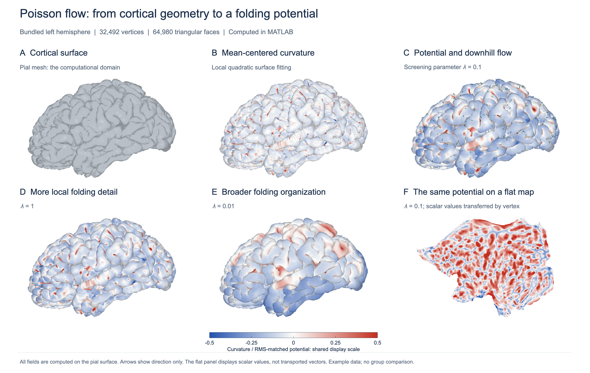

# Poisson Flow Model of Cortical Folding Pattern

**MATLAB tools for representing cortical folding through curvature, a Poisson potential, and surface flow.**

This package starts with a triangulated cortical surface, estimates its signed mean curvature, and solves a screened Poisson equation on the mesh. The resulting potential summarizes folding organization across the surface, while its gradient describes the direction of local change. The repository contains the implementation, example surfaces, and teaching material accompanying our studies of cortical folding and juvenile myoclonic epilepsy.



**From geometry to a spatial representation of folding.** The figure uses the bundled left-hemisphere mesh: 32,492 vertices and 64,980 faces. A–C show the surface, curvature, and potential with downhill arrows. D–E illustrate how the screening parameter changes spatial detail. F displays the same vertexwise potential on the corresponding flat surface. All scalar panels share the display range; potentials are RMS-matched to the curvature source by the supplied solver. [Figure methods](assets/readme/FIGURE.md) · [MATLAB source](assets/readme/generate_readme_figure.m)

## What the package can do

| Step | Output | Included code |
|---|---|---|
| Read cortical geometry | Pial, inflated, and flat surface representations in GIfTI format. | Bundled [`@gifti`](%40gifti), example `.gii` files |
| Estimate local folding | Quadratic surface coefficients and signed mean curvature at each vertex. | [`surf2quadratic`](surf2quadratic.m), [`surf2curvature`](surf2curvature.m) |
| Assemble surface operators | Sparse finite-element mass and stiffness matrices. | [`FEM`](FEM.m) |
| Compute a folding potential | Mean-centered, RMS-normalized solution of the screened or ordinary Poisson problem. | [`FEM_poisson_regualarized`](FEM_poisson_regualarized.m) |
| Inspect scalar fields and flow | Surface color maps, mesh views, and direction-only arrows. | [`figure_trimesh`](figure_trimesh.m), [`figure_wire`](figure_wire.m), [`flux_to_display`](flux_to_display.m) |

The main walkthrough is [`SCRIPT-poisson.mlx`](SCRIPT-poisson.mlx). A second tutorial, [`SCRIPT-gradientfields.mlx`](SCRIPT-gradientfields.mlx), introduces gradients, contours, and streamlines on a synthetic two-dimensional field. Their final problem sections are exercises for further implementation, including path tracing on cortical meshes.

## Quick start

Download or clone the repository and set it as the MATLAB current folder. Add the repository root to the path so MATLAB can find the functions and the bundled GIfTI class:

```matlab
addpath(pwd);
open('SCRIPT-poisson.mlx');
```

For a minimal computation and visualization:

```matlab
pial = gifti('pial.surfL.gii');
surf = struct('vertices', double(pial.vertices), ...
              'faces', double(pial.faces));

beta = surf2quadratic(surf);
curvatures = surf2curvature(beta);
h = curvatures.mean(:);

lambda = 0.1;
[u, Jf] = FEM_poisson_regualarized(surf, h, lambda);

figure;
figure_trimesh(surf, u, 'rywb');
view([-90 0]); clim([-0.5 0.5]); camlight;
flux_to_display(surf, Jf, 55, 2.4, 'face');
title('Poisson folding potential and downhill flow');
```

Keep the existing spelling **`FEM_poisson_regualarized`** when calling the function. The solver centers the curvature source internally, so a separate mean-centering step is not needed in this example.

**Requirements.** The numerical example uses core MATLAB and the bundled GIfTI reader. For compressed GIfTI files, this reader uses Java unless its `zstream` MEX helper has been compiled. If loading reports a Java error, use the Python 3 preparation command below and replace the first filename with `build/readme/pial.surfL.gii`. This creates lossless ASCII copies and requires only Python's standard library. The example and figure were checked in **MATLAB R2026b using this ASCII route**.

## How the model works

For curvature $h$, the solver removes the finite-element area-weighted mean and solves

$$\widetilde h=h-\mathbf{1}\frac{\mathbf{1}^{\mathsf T}Ah}{\mathbf{1}^{\mathsf T}A\mathbf{1}},\qquad (C+\lambda A)w=A\widetilde h,$$

where $A$ is the mass matrix and $C$ the stiffness matrix. For $\lambda=0$, an additional zero-mean constraint fixes the additive constant. For $\lambda>0$, screening controls the balance between broad spatial organization and local folding detail: larger values retain more local structure, while smaller values emphasize broader patterns.

The implementation rescales $w$ to match the mass-weighted RMS of $\widetilde h$ and removes numerical mean drift before returning `u`. Thus, the returned potential is a normalized representation of the solution. The corresponding downhill field is $J=-\nabla_{\mathcal M}u$.

**Current vector convention.** In this source version, the returned array `Jf` has the **uphill** gradient orientation; `flux_to_display` reverses it and normalizes the arrows. The face-mode call above therefore displays downhill directions. For numerical use of the downhill field, use `J = -Jf`. The [figure checks](assets/readme/numerical-checks.json) verify this convention against changes in `u` along triangle edges.

Compute the operators on a closed, nondegenerate pial mesh. Curvature signs depend on mesh orientation. Scalar values can be displayed on corresponding inflated or flat surfaces by vertex index; pial vectors should not be copied unchanged to those surfaces because their tangent geometry differs. The flat mesh also has fewer faces than the pial mesh.

## Reproduce the figure

From the repository root, prepare ASCII copies of the bundled surfaces:

```sh
python3 assets/readme/prepare_demo_surfaces.py
```

Then run in MATLAB:

```matlab
addpath(fullfile(pwd, 'assets', 'readme'));
generate_readme_figure;
```

The script computes the fields with the repository's MATLAB functions, exports one six-panel figure, saves numerical checks in `assets/readme/`, and saves the computed arrays in `build/readme/figure-data.mat`. It checks the screened and ordinary Poisson solves, normalization, mean constraints, vector tangency, and displayed arrow directions. The figure demonstrates the bundled example geometry; it does not reproduce the patient–control comparisons reported in the papers.

## Example files

- [`pial.surfL.gii`](pial.surfL.gii) and [`pial.surfR.gii`](pial.surfR.gii): left- and right-hemisphere pial surfaces.
- [`fs_LR.32k.L.inflated.surf.gii`](fs_LR.32k.L.inflated.surf.gii) and [`fs_LR.32k.L.flat.surf.gii`](fs_LR.32k.L.flat.surf.gii): corresponding left-hemisphere display surfaces.
- [`AAL.32k.L.label.gii`](AAL.32k.L.label.gii): left-hemisphere parcellation labels.

## Publications and teaching material

Chung, M.K., Maccotta, L., and Struck, A. (2026). **Poisson Flow of Cortical Folding in Juvenile Myoclonic Epilepsy.** Extended manuscript with methodology and additional results. [arXiv:2606.08404](https://arxiv.org/abs/2606.08404)

Chung, M.K., Maccotta, L., and Struck, A. (2026). **Poisson Flow Model of Cortical Folding Pattern.** IEEE Engineering in Medicine and Biology Conference (EMBC), pp. 1–5. [Conference paper](chung.2026.EMBC.poisson.pdf) · [arXiv version with corrections](https://arxiv.org/abs/2604.17291)

[Lecture slides](LECTURE-poissonflow.pdf) · [Additional HBM material](chung.2026.HBM.pdf)

Please cite the relevant paper when using the implementation or examples.

## Credits and contact

(C) 2026 Moo K. Chung, University of Wisconsin–Madison.  
Code maintenance and support: [mkchung@wisc.edu](mailto:mkchung@wisc.edu).

The bundled GIfTI reader is by Guillaume Flandin / the SPM project; see its [credits and license information](%40gifti/Contents.m).
